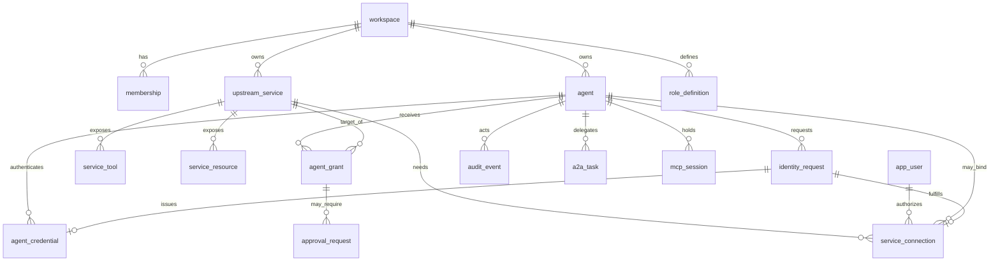

# 03 — Model de date

**Status:** `[x]` entități și invarianți stabiliți; DDL în [`schema.md`](schema.md)
**Owns:** entități, relații, invarianți. Fără logică de autorizare.
**Depends on:** [`../02-architecture/README.md`](../02-architecture/README.md)

## Entități

| Entitate | Rol | Graniță |
|---|---|---|
| `workspace` | tenancy | — |
| `app_user` | om autentificat prin IdP | global, membru în N workspace-uri |
| `agent` | principal mașină | un workspace |
| `agent_credential` | API key sau certificat | un agent |
| `enrollment_token` | token one-time de înrolare, legat de rol și ceiling | un workspace, opțional un agent |
| `enrollment_device_code` | cerere de înrolare aprobată de un om | un workspace, la aprobare |
| `bootstrap_state` | starea bootstrap-ului inițial | global |
| `role_definition` | bundle de permisiuni | builtin global sau custom per workspace |
| `membership` | `(principal, workspace, rol)` | un workspace |
| `upstream_service` | MCP / HTTP / A2A | un workspace |
| `service_tool` | tool descoperit, cu schemă și hash | un serviciu |
| `service_resource` | resursă MCP (URI) | un serviciu |
| `agent_grant` | ce poate apela agentul | `(agent, service)` |
| `service_connection` | credențialul efectiv | triada `(user, agent, service)` |
| `oauth_state` | stare temporară de consimțământ | un flow |
| `identity_request` | cerere de identitate inițiată de agent | un workspace |
| `approval_request` | cerere de acces în așteptare | un workspace |
| `audit_event` | decizie și acțiune | un workspace |
| `usage_counter` | metering agregat | `(workspace, agent, minut)` |
| `idempotency_record` | replay-safe POST | un workspace |
| `a2a_task` | task delegat unui peer | un workspace |
| `mcp_session` | sesiune MCP, dacă upstream-ul o cere | un agent |

## Relații



## Invarianți

Se impun în cod **și** în baza de date, unde se poate.

1. **Granița de workspace.** Orice rând care aparține unui workspace are `workspace_id`, iar orice interogare este filtrată pe el. Test lint: nicio interogare pe tabele tenant-scoped fără `workspace_id`.
2. **`agent.workspace_id = service.workspace_id = grant.workspace_id`.** Un grant nu traversează workspace-uri.
3. **`grant.tools ⊆ service_tool.name`** pentru serviciul respectiv, la momentul scrierii. Tool-urile dispărute din manifest suspendă grantul.
4. **Un grant activ cere o conexiune la call time**, dacă `service.auth_type != 'none'`. Lipsește → `409 connection_required`, nu eroare de politică.
5. **Un agent nu poate acorda ce nu are.** Pentru orice scriere de grant făcută de un agent: `requested_tools ⊆ caller_effective_tools(service)` și `requested_tools ⊆ target.ceiling.tools(service)`.
6. **Un agent nu poate schimba roluri în afară de subsetul propriu.** `permissions(new_role) ⊆ permissions(caller_role)`.
7. **Ștergerea unui serviciu** revocă în cascadă granturile și conexiunile; nu șterge fizic istoricul de audit.
8. **Ștergerea unui agent** revocă credențialele și conexiunile; granturile trec pe `revoked`.
9. **Fiecare mutație produce un `audit_event`** în aceeași tranzacție.
10. **Un `oauth_state` este single-use.** `consumed_at` se setează atomic; al doilea callback primește `400`.
11. **Un `agent_credential` revocat nu mai autentifică**, chiar dacă hash-ul se potrivește.
12. **Consumul nu scade.** `usage_counter` se incrementează atomic; corecțiile se fac prin evenimente de ajustare, nu prin decrement.
13. **Un agent nu își aprobă propria cerere de identitate.** Pentru `requested_by_type = 'agent'`, `approved_by_id != requested_by_id`, iar aprobatorul are `identity:approve` și autoritate cel puțin egală cu binding-ul cerut. Un om își poate auto-aproba propria delegare.
14. **O singură conexiune activă per triadă.** `(service_id, user_id, agent_id)` este unic; reactivarea refolosește rândul, nu creează duplicate.
15. **O conexiune are exact subiecții ceruți de `binding`.** `per_agent` → user + agent; `per_user` → user, fără agent; `workspace` → niciunul. Se impune prin `check constraint`.
16. **O cerere de identitate nu poate depăși ceiling-ul agentului.** Scopurile cerute se intersectează cu `ceiling`-ul și cu grantul existent; restul devine motiv de respingere, nu scope implicit.
17. **Catalogul se actualizează doar prin descoperire.** Niciun request de apel nu scrie în `service_tool`; singura excepție este lazy discover, explicit activat, limitat la o dată pe minut per serviciu.
18. **`runtime_requirements` se calculează la descoperire și nu se editează manual.** Un serviciu cu `streaming`, `session` sau `stdio` este refuzat în anvelopa `request_response` cu `409 persistent_runtime_required`, indiferent de grant.
19. **Un token de înrolare se consumă o singură dată.** Starea trece din `active` în `reserved` sau `consumed`, atomic cu crearea agentului; un CA extern folosește `enrollment_id` pentru idempotență. Rolul și ceiling-ul vin din token, niciodată din body-ul cererii.
20. **Adminul inițial se creează doar prin bootstrap out-of-band.** Niciun request HTTP nu acordă rolul `owner`; `POST /v1/bootstrap` cere tokenul de deployment și se închide după primul workspace.

## Separații care contează

### Grant vs connection

- **Grantul** răspunde la „are voie?".
- **Conexiunea** răspunde la „cu ce credențial?".

Un agent poate avea grant pe un serviciu și nicio conexiune: e starea normală înainte de prima autorizare. UI-ul o arată ca „needs authorization", iar call-ul întoarce link.

### Serviciu vs tool

`service_tool` este normalizat, nu JSON pe serviciu, pentru că:
- grantul referențiază tool-uri individuale cu FK logic și validare;
- `manifest_hash` per tool permite detectarea de rug-pull;
- UI-ul poate pagina și căuta tool-uri fără să parseze un blob.

### Agent vs user

Ambii sunt **principal** în `membership`, dar au tabele separate:
- `app_user` vine din IdP, are email și MFA;
- `agent` are credențiale emise de gateway și un `ceiling`.

Un tabel unic de principal ar simplifica join-urile, dar ar amesteca două cicluri de viață diferite. Se acceptă union-ul la nivel de query.

## Cicluri de viață

```
agent:     active ──► suspended ──► revoked
             │            │
             └────────────┴──► active (reactivare de om)

grant:     pending ──► active ──► suspended ──► revoked
             │           │            │
             │           └──► stale (tool dispărut din manifest)
             └──► denied

connection: active ──► needs_reauth ──► active
                └──► revoked

identity_request:
   pending ──► approved ──► fulfilled ──► revoked
      │            │
      │            └──► expired (link OAuth nefolosit)
      └──► denied
```

Tranziții permise de cine:
- `grant: pending → active` — `grant:approve` sau auto-approve în ceiling.
- `grant: active → suspended` — `grant:write` sau declanșare automată la manifest stale.
- `connection: needs_reauth → active` — doar prin callback OAuth reușit.
- `identity_request: pending → approved` — `identity:approve`; când solicitantul e agent, aprobatorul este un alt principal.
- `identity_request: approved → fulfilled` — prin callback OAuth reușit sau prin emiterea credențialului.
- `agent: active → revoked` — `agent:delete`; ireversibil.

## Volum estimat (v1)

| Tabel | Rânduri la 12 luni | Creștere |
|---|---|---|
| `agent` | 10^3 | lent |
| `service_tool` | 10^4 | mediu |
| `agent_grant` | 10^4 | lent |
| `service_connection` | 10^4 | lent |
| `audit_event` | 10^8 | rapid, partiționat lunar |
| `usage_counter` | 10^7 | rapid, TTL 90 zile |

`audit_event` se partiționează pe lună (`PARTITION BY RANGE (ts)`), cu retenție configurabilă și export în object storage înainte de drop.
